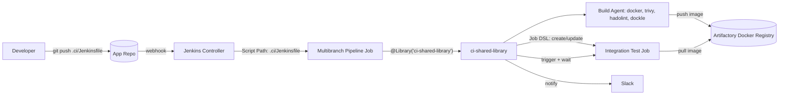
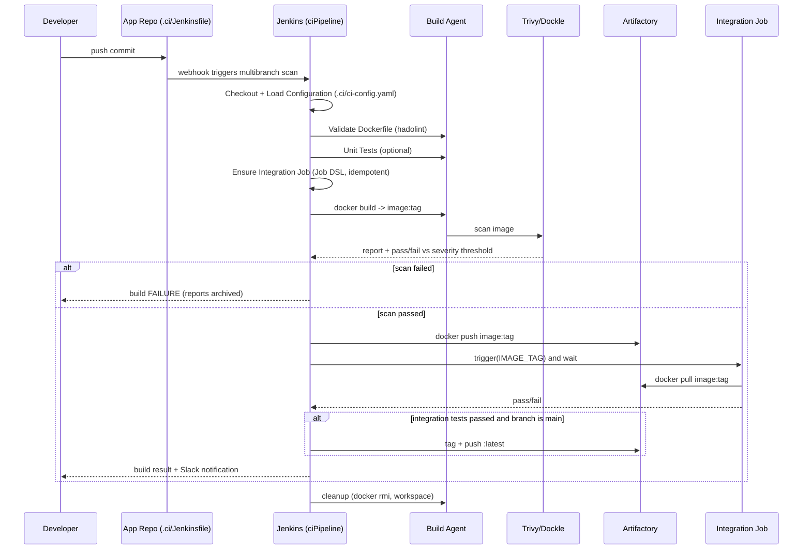
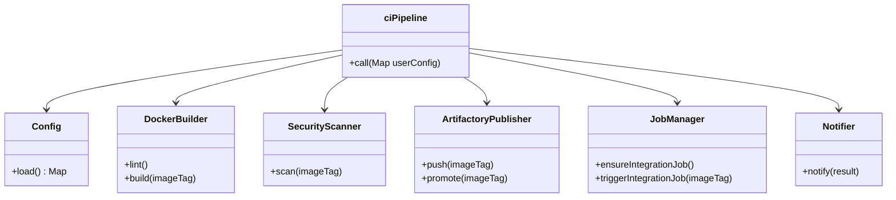
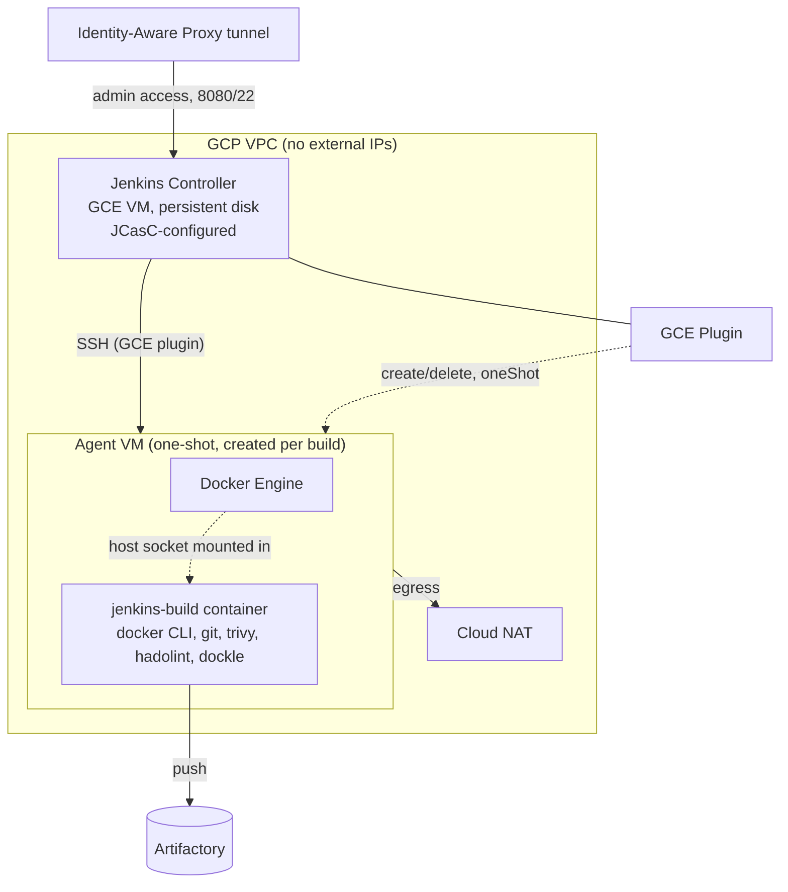

# Architecture

## System context

## Pipeline sequence

## Library component diagram

## Key design decisions

- **Scripted pipeline inside `vars/ciPipeline.groovy`** rather than declarative, because
  stage list depends on configuration only known after checkout (e.g. whether
  `.ci/ci-config.yaml` enables unit tests or inline integration tests). Declarative's
  static stage graph doesn't support this without heavier workarounds.
- **Integration tests run in a separate, generated Jenkins job** instead of inline
  steps. This lets integration tests use their own environment lifecycle
  (docker-compose, ephemeral namespace, etc.), be re-run independently of a full CI
  build, and keeps the CI job focused on build/scan/publish. The companion job's
  *pipeline definition* still lives in the consumer repo (`.ci/integration-Jenkinsfile`)
  so teams own their own test logic; the shared library only owns job provisioning and
  orchestration (`integrationTestMode: inline` is available for teams that prefer a
  single-job model instead).
- **Promotion is separate from publish**: the versioned tag is pushed immediately
  (so it exists for the integration job to pull), but the floating `:latest` tag is
  only created after integration tests succeed, preventing a broken image from ever
  being `:latest`.
- **Registry push is gated by branch** (`pushEnabled`) so every branch/PR still gets a
  full build + scan for fast feedback, without polluting the registry with
  non-release images.
- **Config precedence** `defaults -> .ci/ci-config.yaml -> ciPipeline(...) args` lets
  platform defaults apply everywhere, repos self-serve common overrides via a
  versioned file, and still allows one-off overrides directly in the Jenkinsfile.

## GCP infrastructure (`infra/`)

The controller and agents are provisioned as code - see [infra/README.md](../infra/README.md)
for deployment steps.

Why the agent VM stays minimal (Java, SSH, Docker Engine only) while all build
tooling lives in the `jenkins-build` image: the Jenkins GCE plugin launches
agents over **SSH** and starts a plain Java remoting process — it has no native
"run the agent as a container" mode. Keeping tooling in a container instead of
baking it onto the VM means `ciPipeline()`'s `buildImage` can be versioned and
upgraded independently of the (rarely-changing) machine image, and keeps the
Packer image small and fast to boot for one-shot agents.

