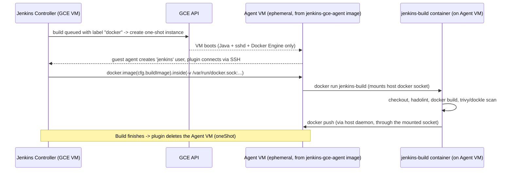

# Infrastructure as Code: Jenkins on GCP with ephemeral Docker build agents

Provisions:

- A Jenkins **controller** on a GCE VM (Terraform), configured entirely via
  **Jenkins Configuration as Code (JCasC)** - no manual UI setup.
- A **custom GCE machine image** (Packer) for agent VMs: just Java, SSH, and
  Docker Engine - the minimum the Jenkins GCE plugin and Docker Pipeline need.
- A **pipeline build Docker image** carrying `docker` CLI, `git`, `trivy`,
  `hadolint`, `dockle` - this is what `ciPipeline()` actually runs its stages
  inside, via `docker.image(cfg.buildImage).inside(...)`.
- **User access management**: a bootstrap local admin (password generated into
  Secret Manager, never stored in this repo) plus role-based authorization
  (`admin` vs `authenticated` roles) via JCasC.
- **Shared library registration**: `ci-shared-library` is registered as a
  Global Pipeline Library automatically via JCasC - no manual
  *Manage Jenkins -> Global Pipeline Libraries* step.
- **Automatic job/pipeline creation**: a GitHub Organization Folder (JCasC
  `jobs:` + Job DSL) auto-discovers every repo with a `.ci/Jenkinsfile` and
  creates its multibranch pipeline job - no manual *New Item* per repo.

Agent VMs are created by the Jenkins GCE plugin **only when a build is queued**
(`oneShot: true`) and deleted immediately after, so you pay for compute only
during an active build.

```
infra/
  packer/                       GCE agent machine image (Java + SSH + Docker)
    gce-agent-image.pkr.hcl
    scripts/
  docker/
    jenkins-build/               Image pipeline stages run inside (trivy, hadolint, dockle, docker CLI)
    jenkins-controller/          Optional: controller image with plugins pre-baked
  terraform/                     Network, IAM, controller VM, JCasC config
    casc/jenkins.yaml.tftpl
```

## How a build actually runs



## Prerequisites

- A GCP project with the Compute Engine API enabled.
- `gcloud`, `packer` (>= 1.9), and `terraform` (>= 1.5) installed locally.
- Docker, to build and push the `jenkins-build` (and optional
  `jenkins-controller`) images to Artifact Registry.
- An Artifact Registry Docker repository, e.g.:
  ```
  gcloud artifacts repositories create ci \
    --repository-format=docker --location=us --project=$PROJECT_ID
  ```

## 1. Build and push the pipeline build image

```bash
cd infra/docker/jenkins-build
docker build -t us-docker.pkg.dev/$PROJECT_ID/ci/jenkins-build:latest .
docker push us-docker.pkg.dev/$PROJECT_ID/ci/jenkins-build:latest
```

Set this as the `buildImage` default in repos' `.ci/ci-config.yaml` (or override
the shared library's default in [../test/src/org/ci/Config.groovy](../test/src/org/ci/Config.groovy)).

## 2. Build the GCE agent machine image

```bash
cd infra/packer
packer init gce-agent-image.pkr.hcl
packer build \
  -var "project_id=$PROJECT_ID" \
  -var "build_image=us-docker.pkg.dev/$PROJECT_ID/ci/jenkins-build:latest" \
  gce-agent-image.pkr.hcl
```

This creates/refreshes an image in the `jenkins-gce-agent` family. Re-run it
whenever you need to patch the base OS, Docker version, or pre-pulled image.

## 3. Bake plugins into the controller image (required)

The JCasC config now references `role-strategy` and `github-branch-source`
(for user access management and auto job creation), so this step is **no
longer optional** - the stock `jenkins/jenkins:lts-jdk17` image will fail to
apply the full configuration.

```bash
cd infra/docker/jenkins-controller
docker build -t us-docker.pkg.dev/$PROJECT_ID/ci/jenkins-controller:latest .
docker push us-docker.pkg.dev/$PROJECT_ID/ci/jenkins-controller:latest
```

## 4. Deploy with Terraform

All non-sensitive variables live in one place -
[terraform.tfvars](terraform/terraform.tfvars.example): copy the example,
fill in your values, and `terraform apply` auto-loads it (no `-var`/`-var-file`
flags needed). Anything left blank that has no default (e.g. `project_id`,
`shared_library_repo_url`) will simply prompt you for it interactively.

```bash
cd infra/terraform
cp terraform.tfvars.example terraform.tfvars   # then edit terraform.tfvars
terraform init
TF_VAR_github_token="<github PAT, repo scope>" terraform apply
```

`github_token` is deliberately **not** in `terraform.tfvars` - it's sensitive,
so it's excluded by `.gitignore` and must be passed via the
`TF_VAR_github_token` environment variable instead, so it never lands in
shell history or a committed file. Leave `github_org` blank in `terraform.tfvars`
to skip the auto-discovery job.

This provisions the VPC/subnet/NAT/firewall rules, the controller + agent
service accounts (least privilege, kept separate per GCE plugin guidance), the
controller VM (persistent disk for `JENKINS_HOME`, JCasC config rendered from
[casc/jenkins.yaml.tftpl](terraform/casc/jenkins.yaml.tftpl)), a generated admin
password in Secret Manager, and outputs the controller's internal IP.

The controller has **no external IP**. Reach it via an IAP tunnel:

```bash
gcloud compute start-iap-tunnel jenkins-controller 8080 \
  --local-host-port=localhost:8080 --zone=$ZONE
```

Then open `http://localhost:8080` and log in as `admin` (or your
`admin_username`) with the password from:

```bash
gcloud secrets versions access latest --secret=jenkins-admin-password --project=$PROJECT_ID
```

## 5. Onboard repos

Nothing left to do per-repo beyond adding `.ci/Jenkinsfile` (see
[../test/examples/consumer-repo](../test/examples/consumer-repo)) - the
Organization Folder created in step 4 discovers it automatically. For anything
not covered here (credentials for Artifactory, Slack, etc.), see
[../test/docs/JENKINS_SETUP.md](../test/docs/JENKINS_SETUP.md).

## What's covered vs. what's still manual

| Area | Status |
|---|---|
| GCP cloud agent (machine image, GCE cloud config, IAM) | Automated |
| Shared library registration | Automated (JCasC `globalLibraries`) |
| User access management | Automated baseline: local bootstrap admin + role-based authorization (`admin`/`authenticated`). Not SSO - see below. |
| Pipeline job creation | Automated for GitHub repos via the Organization Folder (step 4). Non-GitHub SCMs need a different branch-source plugin. |
| Artifactory / Slack credentials | **Manual** - see [../test/docs/JENKINS_SETUP.md](../test/docs/JENKINS_SETUP.md) |
| TLS/HTTPS, custom domain, backups/DR | **Not covered** - add a load balancer + managed cert and a disk-snapshot schedule for `jenkins-home` if needed |
| SSO (Google/SAML/LDAP) | Not implemented - the `google-oauth-plugin` in `plugins.txt` is only a dependency of the GCE plugin, not a login method. Swap the `local` `securityRealm` in [casc/jenkins.yaml.tftpl](terraform/casc/jenkins.yaml.tftpl) for your SSO plugin of choice if needed. |

The Organization Folder's Job DSL (`jobs:` block in the CasC file) uses method
names (`organizationFolder`, `workflowMultiBranchProjectFactory`, etc.) that are
plugin-version-dependent. If it fails to apply on first deploy, check the
Jenkins logs and validate the script against
`<jenkins-url>/plugin/job-dsl/api-viewer/index.html` before relying on it -
the rest of the JCasC config still applies even if this one block fails.

## Notes and trade-offs

- **Authentication**: the controller uses its own attached GCP service account
  (`googleRobotMetadata` credential type) - no JSON key material is stored
  anywhere in this repo or in Jenkins credentials.
- **Networking**: agents have no external IP; Cloud NAT provides outbound
  internet access (image pulls, CVE DB updates). Firewall rules only allow the
  controller to reach agents on port 22, plus IAP-tunneled access for admins.
- **Docker-outside-of-Docker**: the agent VM's Docker socket is mounted into
  the `jenkins-build` container rather than running nested/privileged Docker,
  which is both faster and avoids privileged-container risk.
- **One-shot agents**: guarantees a clean, unmodified environment per build and
  minimizes cost, at the expense of a cold-start delay per build (mitigated by
  pre-pulling `jenkins-build` into the machine image in step 2).
